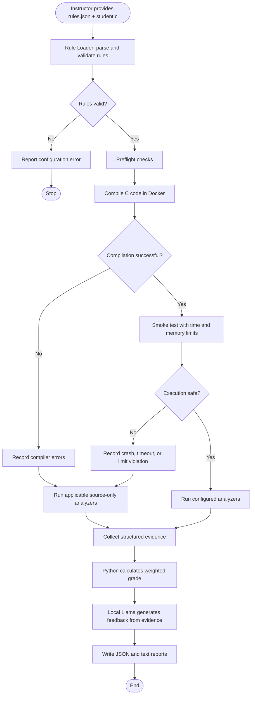

# Code Checking Assistant

A prototype automated C-code grader using Python, a local `llama.cpp` server, and Docker-based isolation.

## Prerequisites

- Conda (or Python 3.11+)
- `llama-server` installed and available on `PATH`
- Docker installed and running (for sandbox development)

## Install

From the project root, create and activate the Conda environment (skip creation if it already exists):

```bash
conda create -n code python=3.11 -y
conda activate code
python -m pip install --upgrade pip
python -m pip install -e . docker
```

## Start the application

From the project root, run:

```bash
cd src
python grading_agent/main.py
```

This starts the local Llama server. Press `Ctrl + C` to stop it. Configure the model, host, and port in `src/grading_agent/config/settings.py`; set `LLAMA_SERVER` if the executable is not on `PATH`.

To build the current sandbox image, return to the project root and run:

```bash
cd ..
docker build -f Dockerfile.sandbox -t agent-sandbox:latest .
```

## Troubleshooting

- **Conda environment not found:** Create it with `conda create -n code python=3.11 -y`.
- **Llama server fails to start:** Install `llama-server`, ensure it is on `PATH`, or set `LLAMA_SERVER` to its full path.
- **Python module errors:** Activate `code` and install dependencies with `python -m pip install -e . docker` from the project root.


## Planned Grading Workflow

The flowchart below shows the intended end-to-end design. The grading coordinator and analyzers are **not implemented yet**; the current startup command launches the local Llama server.



## Current status

This is an early scaffold. The full grading coordinator, rule loading, C compilation and execution, analyzers, scoring, and report generation still need implementation. The sandbox image is currently Python-only and does not yet include a C compiler or memory-analysis tools.
